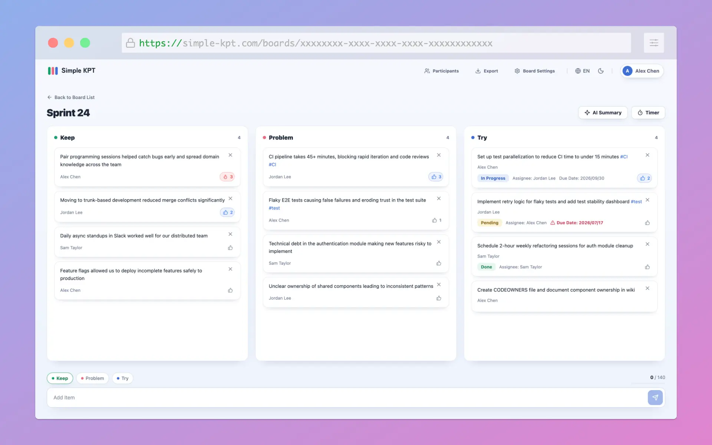

<p align="right">
  <a href="./README.md">JA</a> | EN
</p>

<div align="center">
  
  &nbsp;&nbsp;&nbsp;
  <a href="https://simple-kpt.com" target="_blank" rel="noopener">
    <picture>
      <source media="(prefers-color-scheme: dark)" srcset="./public/logotype-dark.svg">
      <source media="(prefers-color-scheme: light)" srcset="./public/logotype.svg">
      
    </picture>
  </a>
</div>

<br>

<div align="center">
  <h3>Make team retrospectives refreshingly simple.</h3>
  <p>No sign-up. Just share a URL<br>and start your team retrospective right away.</p>
</div>

<br>

<div align="center">
  <a href="https://simple-kpt.com/demo" target="_blank" rel="noopener">
    
  </a>
</div>

<br>

<div align="center">

[](https://github.com/hogesuke/simple-kpt/actions/workflows/ci.yml)
[](https://github.com/hogesuke/simple-kpt/blob/main/LICENSE)


</div>

<br>

<div align="center">
  <a href="https://simple-kpt.com/demo" target="_blank" rel="noopener">
    <picture>
      <source media="(prefers-color-scheme: dark)" srcset="./docs/screenshots/board-dark.webp">
      
    </picture>
  </a>
</div>

<br>

## Lighthouse Scores


## Features

- 🔗 No sign-up. Just share a URL to join as a team
- 🔒 No server storage. Board contents stay on participants' devices
- 👥 Real-time collaborative editing
- 🔄 Resume by reopening the same URL
- ⏱️ Timer (with an option to hide other people's cards)
- 👍 Voting
- ✅ Assignees, statuses, and due dates for Try items
- 📥 Export (Markdown / CSV / JSON for resuming)
- 🌓 Dark Mode
- 🌐 Multilingual Support (Japanese / English)

## How It Works

Board contents are not stored on any server. Participants' browsers sync directly with each other over WebRTC.

```
Participant A ─┐                                   ┌─ Participant B
               │  (1) Connection relay (encrypted)  │
               └──────── Signaling server ──────────┘
                        (Cloudflare Workers)
Participant A ◀────── (2) Direct sync (WebRTC) ──────▶ Participant B
```

- **Sync**: [Yjs](https://github.com/yjs/yjs) (CRDT) merges concurrent edits without conflicts.
- **Connection relay**: Uses a self-hosted signaling server (Cloudflare Workers + Durable Objects) with the same message format as [Trystero](https://github.com/dmotz/trystero)'s ws-relay strategy. Connection information is encrypted with the key after `#` in the invite URL, so the signaling server cannot read it. Board contents never pass through it.
- **Storage**: Boards you join are stored in each participant's browser (IndexedDB), and you can resume by reopening the same invite URL.
- **Clock skew**: The timer uses a "room clock" based on the room creator's clock to correct differences between participants' device clocks.

## Tech Stack

- TypeScript
- React 19
- Tailwind CSS 4
- Yjs
- Trystero
- Zustand
- React Hook Form
- Zod
- shadcn/ui
- i18next
- Vite
- Vitest
- Playwright
- Storybook

## Infrastructure

- Vercel (frontend)
- Cloudflare Workers (signaling server)

## Requirements

- Node.js 24+

## Local Development

### Installation

```bash
pnpm install --frozen-lockfile
```

### Environment Variables

Create `.env.local` if needed (see `.env.local.example`).

```bash
# Signaling server URL (if not set, ws://localhost:8787 is used during development)
VITE_SIGNALING_URL=ws://localhost:8787
```

### Start

Start the signaling server and the app in separate terminals.

```bash
# Signaling server (http://localhost:8787)
pnpm signaling:dev

# App (http://localhost:5173)
pnpm dev
```

To check syncing between multiple people, open the same invite URL in browsers with separate storage, such as a normal window and a private window.

## Deployment

### Signaling server (Cloudflare Workers)

```bash
npx wrangler login
pnpm signaling:deploy
```

- Allowed origins are configured with `ALLOWED_ORIGINS` in `signaling/wrangler.jsonc`.
- Workers Logs is disabled so that logs such as client IP addresses are not stored.

### Frontend (Vercel)

- Set the environment variable `VITE_SIGNALING_URL` to the signaling server URL (e.g., `wss://signaling.simple-kpt.com`).
- Include the signaling server URL in the Content-Security-Policy (`connect-src`) in `vercel.json`.

## Testing

```bash
# Unit tests
pnpm test

# E2E tests
pnpm e2e

# E2E tests (UI mode)
pnpm e2e:ui
```

## Storybook

### Local

```bash
pnpm storybook
```

### Public URL

https://hogesuke.github.io/simple-kpt/

## Directory Structure

```
.
├── src/
│   ├── components/   # UI Components
│   ├── contexts/     # React Context
│   ├── hooks/        # Custom Hooks
│   ├── lib/
│   │   └── p2p/      # P2P sync, room clock, storage, resume files
│   ├── pages/        # Page Components
│   ├── stores/       # Zustand Stores (demo board)
│   └── types/        # Type Definitions
│
├── signaling/        # Signaling server (Cloudflare Workers)
└── shared/           # Shared constants
```

## License

MIT License
